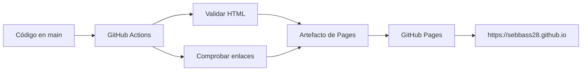

# Currículum web — Juan Sebastián Agudelo Castrillon

Sitio estático con el currículum de [Juan Sebastián Agudelo Castrillon](https://sebbass28.github.io/), perfil junior DevOps / Cloud en Valencia.

La web pública está en **https://sebbass28.github.io**. El PDF descargable (sin número de teléfono) está en [`cv/CV_Juan_Agudelo_Castrillon.pdf`](cv/CV_Juan_Agudelo_Castrillon.pdf).

## Arquitectura

Es un sitio estático de una sola página: HTML, CSS y un poco de JavaScript (cambio de tema claro/oscuro). No hay framework ni servidor propio. GitHub Pages sirve los archivos tal cual.



## Pipeline de despliegue

El flujo está en [`.github/workflows/deploy.yml`](.github/workflows/deploy.yml) y se dispara con cada *push* a `main` (también se puede lanzar a mano).

1. **Checkout** del repositorio.
2. **Validar HTML** con `html-validate`.
3. **Comprobar enlaces** de forma ligera (`scripts/check-links.py`): que existan los archivos locales y las anclas, y una sonda HTTP a los enlaces externos.
4. **Configurar Pages** con `actions/configure-pages`.
5. **Preparar y subir el artefacto** (`index.html`, estilos, script, favicon, imagen Open Graph, PDF y `.nojekyll`).
6. **Desplegar** con `actions/deploy-pages`.

En el pie de la web se indica: «Desplegado automáticamente con GitHub Actions».

## Uso local

Sirve la carpeta del repositorio con cualquier servidor estático, por ejemplo:

```bash
python3 -m http.server 8080
```

Abre `http://localhost:8080`.

## Contenido

El texto de la web coincide con el currículum. En la versión pública no aparece el número de teléfono; el contacto es el correo, LinkedIn y GitHub.
